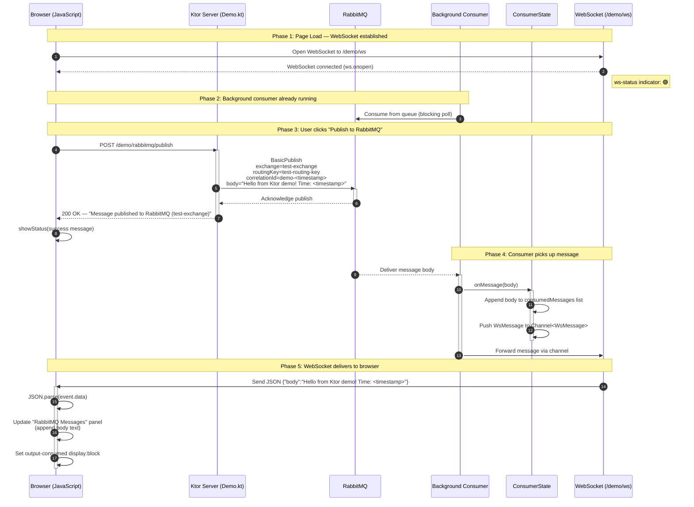
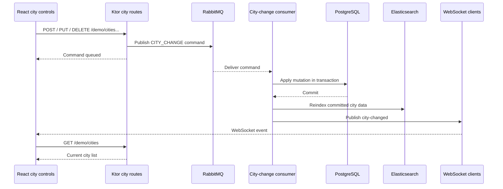
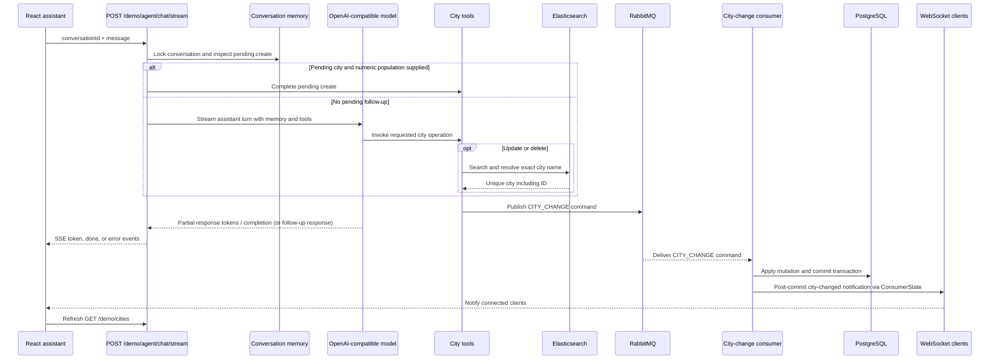

# Solution Design — React City Dashboard, RabbitMQ, and City Assistant

This document describes the end-to-end flows in the Ktor demo application: publishing a RabbitMQ message, managing cities from the React UI, and using the LangChain4j city assistant to stream responses and request city changes.

---

## 1. Client-Side JavaScript

The HTML button at line 101 of [Demo.kt](src/main/kotlin/Demo.kt) calls `publishMessage()`:

```js
async function publishMessage() {
  hideOutputs();
  try {
    const res = await fetch('/demo/rabbitmq/publish', { method: 'POST' });
    const text = await res.text();
    if (res.ok) {
      showStatus('RabbitMQ message published to test-exchange ...', 'success');
    }
  } catch(e) { showStatus('Error: ' + e.message, 'error'); }
}
```

- Clears any previous output/status UI.
- Sends a **POST request to `/demo/rabbitmq/publish`** (no body).
- On success, shows a green status bar message.

---

## 2. Server-Side Route Handler

The Ktor route is registered at lines 262–273 of [Demo.kt](src/main/kotlin/Demo.kt):

```kotlin
rabbitmq {
    post("/demo/rabbitmq/publish") {
        basicPublish {
            exchange = "test-exchange"
            routingKey = "test-routing-key"
            properties = basicProperties { correlationId = "demo-${System.currentTimeMillis()}" }
            message { "Hello from Ktor demo! Time: ${System.currentTimeMillis()}" }
        }
        call.respondText("Message published to RabbitMQ (test-exchange)", ContentType.Text.Plain)
    }
}
```

- A `BasicProperties` object is created with a `correlationId` of the form `"demo-<timestamp>"`.
- The message body is the string `"Hello from Ktor demo! Time: <timestamp>"`.
- The message is **published synchronously** to the RabbitMQ exchange `test-exchange` using routing key `test-routing-key`.
- The HTTP response `200 OK` is sent back to the browser immediately (the publish does **not** wait for a consumer).

---

## 3. Background Consumer

A background RabbitMQ consumer is already running (set up at application startup in [Rabbitmq.kt](src/main/kotlin/Rabbitmq.kt)). When the consumer picks up the published message:

- It calls `ConsumerState.onMessage(body)` ([ConsumerState.kt](src/main/kotlin/ConsumerState.kt)), which appends the body string to `ConsumerState.consumedMessages`.
- It also pushes a `WsMessage` into a `Channel<WsMessage>`.

---

## 4. WebSocket Delivery

The client opened a WebSocket to `/demo/ws` on page load ([Demo.kt](src/main/kotlin/Demo.kt), line 158). The server side ([Websocket.kt](src/main/kotlin/Websocket.kt)) listens on the `ConsumerState.messages` channel and forwards each `WsMessage` to all connected WebSocket sessions.

On the client side, the `ws.onmessage` handler (Demo.kt, line 144–149) receives the JSON payload and appends the body text to the "RabbitMQ Messages" panel on the page.

---

## 5. Sequence Diagram



---

## 6. Key Data Flow

> **Click** → `POST /demo/rabbitmq/publish` → **Ktor** → `BasicPublish` → **RabbitMQ** `test-exchange` → **Background Consumer** → `ConsumerState.onMessage()` → `Channel<WsMessage>` → **WebSocket** broadcast → **Browser** updates DOM

---

## 7. Relevant Source Files

| File | Purpose |
|---|---|
| [src/main/kotlin/Demo.kt](src/main/kotlin/Demo.kt) | Ktor routing, embedded HTML/JS, publish endpoint |
| [src/main/kotlin/Rabbitmq.kt](src/main/kotlin/Rabbitmq.kt) | RabbitMQ module plugin, connection setup, consumer bootstrap |
| [src/main/kotlin/ConsumerState.kt](src/main/kotlin/ConsumerState.kt) | Shared mutable state for consumed messages |
| [src/main/kotlin/Websocket.kt](src/main/kotlin/Websocket.kt) | WebSocket route that broadcasts messages to clients |
| [src/main/resources/application.yaml](src/main/resources/application.yaml) | RabbitMQ connection configuration (host, port, vhost, credentials) |

---

## 8. React City Dashboard and Direct City Changes

The React application is served under `/app/`. Its city controls use the existing Ktor REST routes rather than accessing PostgreSQL or Elasticsearch directly:

| Action | Request | Result |
|---|---|---|
| List cities | `GET /demo/cities` | Returns the persisted city records. |
| Search by name | `GET /demo/cities/search?name=...` | Searches the Elasticsearch `cities` index. The React input debounces keystrokes by 20 ms and cancels stale requests. |
| Create city | `POST /demo/cities` | Enqueues a `CITY_CHANGE` command with the name and population; the database generates the ID. |
| Update city | `PUT /demo/cities/{id}` | Enqueues a command containing the existing ID, new name, and population. |
| Delete city | `DELETE /demo/cities/{id}` | Enqueues a command containing the ID. |

City mutations do not write to the database in the HTTP request. The Ktor route publishes a command to `test-exchange` with routing key `test-routing-key`, and returns after the command has been published. The RabbitMQ consumer parses the command and `CityChangeProcessor` applies it using a dedicated JDBC connection and transaction. After a successful commit, it reads the cities, attempts to rebuild the Elasticsearch index, and sends `city-changed` through `ConsumerState`; connected WebSocket clients receive the event and reload the city list. Elasticsearch reindex errors are logged and do not roll back an already committed database change.



The WebSocket channel is broadcast to connected clients, so a change made by one browser causes each connected React page to refresh its list. A manual refresh uses the same `GET /demo/cities` read path.

---

## 9. LangChain4j City Assistant

The React assistant sends a JSON request to `POST /demo/agent/chat/stream`:

```json
{
  "conversationId": "browser-session-conversation-id",
  "message": "Update Oslo to a population of 710000"
}
```

The request requires a non-blank conversation ID (at most 128 characters) and a non-blank message of at most 4,000 characters. The configured LangChain4j `OpenAiStreamingChatModel` connects to the OpenAI-compatible chat-completions service. `llm.base-url` and `llm.model-name` are configured in `application.yaml`; the default model is `openai/gpt-oss-20b`. The configured full chat-completions URL is normalized to its API base URL by the backend. `LLM_API_KEY` supplies the API key when the model service requires one; credentials should be supplied through the runtime environment, not committed to source control.

The backend sends Server-Sent Events (`Content-Type: text/event-stream`) as JSON data frames. `token` events contain partial response text, `done` marks successful completion, and `error` signals an assistant failure with a user-safe message. The React service incrementally parses these frames and appends token content to the current assistant message, producing the typing effect.

### Conversation memory and orchestration

- The client keeps a conversation ID in browser session storage and reuses it on subsequent turns in that tab/session.
- The backend registry creates a `MessageWindowChatMemory` per conversation and retains up to 20 messages. A per-conversation mutex serializes turns so simultaneous requests cannot mutate the same memory or pending operation concurrently.
- In parallel with the model's bounded message window, the registry keeps a bounded, ordered activity timeline of user messages, completed assistant replies, and city operations successfully queued during this conversation. The history tool exposes that timeline so follow-up questions about prior actions (including deletions later reversed by a create) are answered from recorded events rather than only the current city index. At most 100 timeline entries are retained.
- The assistant panel's **Restart** action calls `POST /demo/agent/conversation/reset` with the active conversation ID. The backend waits for that conversation's mutex, clears its chat memory, activity timeline, and pending create name, then acknowledges; only after success does the client clear the displayed transcript. The same conversation ID can then be reused as a fresh conversation.
- The assistant is instructed to use its tools for requested city changes, never invent a database ID or population, and resolve update/delete targets by exact city name.
- For city-related questions, the assistant uses a list tool to provide registered city names and populations; when a particular city is mentioned, it uses an exact-name lookup tool to confirm existence and report its current indexed population.
- If a create request omits population, the create tool retains the pending city name in that conversation and asks the user for the missing value. A subsequent whole-number population completes the pending creation; an invalid answer requests the population again, and `cancel` clears the pending create.

### City tools and persistence boundary

The assistant exposes list, specific-city lookup, conversation operation-history, create, update, and delete tools. The history tool reports the ordered user/assistant/activity timeline. Each successfully enqueued create, update, or delete is recorded with its city name and available population details; failed enqueues do not appear as completed/queued operations. Create accepts the city name and population; its command omits the ID so PostgreSQL can generate it. For update and delete, the tool searches Elasticsearch, filters results to a case-insensitive exact name match, and proceeds only when exactly one city matches. No match, multiple matches, or unavailable search results are reported rather than guessing an entity.

The tools enqueue the same `CITY_CHANGE` RabbitMQ commands used by the React CRUD controls. They do not update PostgreSQL or Elasticsearch directly. The resulting database transaction, Elasticsearch reindex attempt, and `city-changed` WebSocket notification therefore follow the existing shared pipeline, and connected clients refresh in the same way regardless of whether the change came from the form or the assistant. Assistant responses explicitly describe these operations as queued; a successful tool call means the command was published, not that asynchronous persistence has already completed.



The request/response stream and the mutation pipeline are intentionally asynchronous and separate: SSE reports the assistant's response, while the WebSocket event reports completion of the database operation and triggers the city-list refresh.

---

## 10. Additional Relevant Source Files

| File | Purpose |
|---|---|
| [frontend/src/app/App.tsx](frontend/src/app/App.tsx) | React city dashboard and conversation UI; listens for city-change events through the WebSocket hook and refreshes city data. |
| [frontend/src/services/demoApi.ts](frontend/src/services/demoApi.ts) | REST calls for city operations and incremental parsing of assistant SSE events. |
| [frontend/src/hooks/useMessages.ts](frontend/src/hooks/useMessages.ts) | WebSocket connection, message handling, and reconnect behavior. |
| [src/main/kotlin/CityAgent.kt](src/main/kotlin/CityAgent.kt) | LangChain4j model setup, conversation memory, SSE endpoint, request validation, and city tools. |
| [src/main/kotlin/CityCommandPublisher.kt](src/main/kotlin/CityCommandPublisher.kt) | Publishes assistant-generated city commands to RabbitMQ. |
| [src/main/kotlin/CityChangeProcessor.kt](src/main/kotlin/CityChangeProcessor.kt) | Applies city commands transactionally, reindexes Elasticsearch, and emits the city-change WebSocket event. |
| [src/main/kotlin/Elasticsearch.kt](src/main/kotlin/Elasticsearch.kt) | City indexing, full reindexing, and name search used by the dashboard and assistant tools. |
