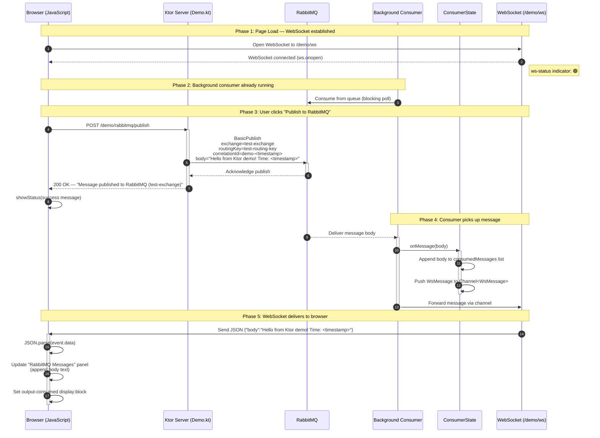

# Solution Design — RabbitMQ Message Publishing Flow

This document describes the complete end-to-end cycle triggered when the user clicks **"Publish to RabbitMQ"** in the Ktor demo application.

---

## 1. Client-Side JavaScript

The HTML button at line 101 of [Demo.kt](src/main/kotlin/Demo.kt) calls `publishMessage()`:

```js
async function publishMessage() {
  hideOutputs();
  try {
    const res = await fetch('/demo/rabbitmq/publish', { method: 'POST' });
    const text = await res.text();
    if (res.ok) {
      showStatus('RabbitMQ message published to test-exchange ...', 'success');
    }
  } catch(e) { showStatus('Error: ' + e.message, 'error'); }
}
```

- Clears any previous output/status UI.
- Sends a **POST request to `/demo/rabbitmq/publish`** (no body).
- On success, shows a green status bar message.

---

## 2. Server-Side Route Handler

The Ktor route is registered at lines 262–273 of [Demo.kt](src/main/kotlin/Demo.kt):

```kotlin
rabbitmq {
    post("/demo/rabbitmq/publish") {
        basicPublish {
            exchange = "test-exchange"
            routingKey = "test-routing-key"
            properties = basicProperties { correlationId = "demo-${System.currentTimeMillis()}" }
            message { "Hello from Ktor demo! Time: ${System.currentTimeMillis()}" }
        }
        call.respondText("Message published to RabbitMQ (test-exchange)", ContentType.Text.Plain)
    }
}
```

- A `BasicProperties` object is created with a `correlationId` of the form `"demo-<timestamp>"`.
- The message body is the string `"Hello from Ktor demo! Time: <timestamp>"`.
- The message is **published synchronously** to the RabbitMQ exchange `test-exchange` using routing key `test-routing-key`.
- The HTTP response `200 OK` is sent back to the browser immediately (the publish does **not** wait for a consumer).

---

## 3. Background Consumer

A background RabbitMQ consumer is already running (set up at application startup in [Rabbitmq.kt](src/main/kotlin/Rabbitmq.kt)). When the consumer picks up the published message:

- It calls `ConsumerState.onMessage(body)` ([ConsumerState.kt](src/main/kotlin/ConsumerState.kt)), which appends the body string to `ConsumerState.consumedMessages`.
- It also pushes a `WsMessage` into a `Channel<WsMessage>`.

---

## 4. WebSocket Delivery

The client opened a WebSocket to `/demo/ws` on page load ([Demo.kt](src/main/kotlin/Demo.kt), line 158). The server side ([Websocket.kt](src/main/kotlin/Websocket.kt)) listens on the `ConsumerState.messages` channel and forwards each `WsMessage` to all connected WebSocket sessions.

On the client side, the `ws.onmessage` handler (Demo.kt, line 144–149) receives the JSON payload and appends the body text to the "RabbitMQ Messages" panel on the page.

---

## 5. Sequence Diagram



---

## 6. Key Data Flow

> **Click** → `POST /demo/rabbitmq/publish` → **Ktor** → `BasicPublish` → **RabbitMQ** `test-exchange` → **Background Consumer** → `ConsumerState.onMessage()` → `Channel<WsMessage>` → **WebSocket** broadcast → **Browser** updates DOM

---

## 7. Relevant Source Files

| File | Purpose |
|---|---|
| [src/main/kotlin/Demo.kt](src/main/kotlin/Demo.kt) | Ktor routing, embedded HTML/JS, publish endpoint |
| [src/main/kotlin/Rabbitmq.kt](src/main/kotlin/Rabbitmq.kt) | RabbitMQ module plugin, connection setup, consumer bootstrap |
| [src/main/kotlin/ConsumerState.kt](src/main/kotlin/ConsumerState.kt) | Shared mutable state for consumed messages |
| [src/main/kotlin/Websocket.kt](src/main/kotlin/Websocket.kt) | WebSocket route that broadcasts messages to clients |
| [src/main/resources/application.yaml](src/main/resources/application.yaml) | RabbitMQ connection configuration (host, port, vhost, credentials) |
